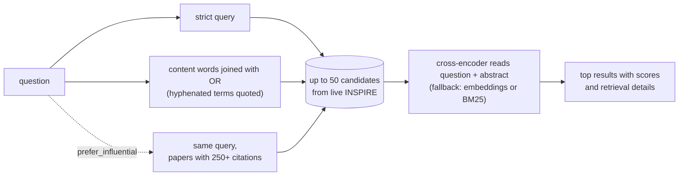

# inspire-mcp

[](https://github.com/OWNER/inspire-mcp/actions/workflows/ci.yml)
[](https://github.com/OWNER/inspire-mcp/actions/workflows/eval.yml)
[](LICENSE)

**Semantic search over [INSPIRE-HEP](https://inspirehep.net) for AI assistants.** An
[MCP](https://modelcontextprotocol.io) server that finds high energy physics papers from
natural-language questions, with every retrieval choice backed by a published benchmark.

INSPIRE's search engine is built for its query language: plain-language questions return nothing
70% of the time. `semantic_search` turns a question into candidates from the live INSPIRE index
and reranks them with a cross-encoder, putting the right paper first **70% of the time instead of 38%**
on a benchmark of randomly sampled papers ([evaluation](docs/evaluation.md)). No index to host:
the data stays at INSPIRE.

> Personal project built on the public [INSPIRE REST API](https://github.com/inspirehep/rest-api-doc),
> not affiliated with CERN or INSPIRE. For broad coverage of the INSPIRE API (figures, author metrics,
> formatted reference lists) see also [inspirehep-mcp](https://github.com/MohamedElashri/inspirehep-mcp);
> this project focuses on natural-language retrieval and on measuring it.

## Quickstart

```bash
# Claude Code
claude mcp add inspire -- uvx --from "inspire-mcp[semantic]" inspire-mcp
```

Claude Desktop, Cursor and other clients (`mcpServers` in the client's configuration file):

```json
{
  "mcpServers": {
    "inspire": {
      "command": "uvx",
      "args": ["--from", "inspire-mcp[semantic]", "inspire-mcp"]
    }
  }
}
```

Before the first PyPI release, use `--from "git+https://github.com/OWNER/inspire-mcp"` instead.
Without the `[semantic]` extra the server is lighter (no models) and reranks with BM25.

## Example

A session driven through the MCP protocol by [`examples/demo.py`](examples/demo.py), real output:

```text
> semantic_search: 'using neural networks to accelerate the simulation of calorimeter showers'
  50 candidates from INSPIRE, reranked by cross-encoder:ms-marco-MiniLM-L-6-v2
  1. Accelerating Science with Generative Adversarial Networks: An Application to 3D Particle Showers
     in Multilayer Calorimeters (2018, 258 citations) https://inspirehep.net/literature/1598455
  2. Denoising Convolutional Networks to Accelerate Detector Simulation (2023, 5 citations)
  3. On the use of neural networks for energy reconstruction in high-granularity calorimeters (2021, 38 citations)

> get_paper: 1705.02355
  Paganini, Michela, de Oliveira, Luke, Nachman, Benjamin; Phys.Rev.Lett. 120 042003

> get_citing_papers: recid 1598455, most recent
  258 citing papers, latest:
  - Just CaloCHILL: fast hadronic shower generation in a learned latent space (2026)
  - Localized anomaly detection with a calorimeter normalizing flow (2026)

> get_bibtex
  @article{Paganini:2017hrr, ...
```

## Tools

| Tool | What it does |
|---|---|
| `semantic_search(question, size, pool, prefer_influential, compact)` | papers for a natural-language question |
| `search_literature(query, size, sort, page, compact)` | INSPIRE syntax (`t higgs and cn atlas and date > 2020`), paginated |
| `get_paper(identifier)` | one record by INSPIRE recid, arXiv id or DOI |
| `get_citing_papers(recid, size, sort)` | papers citing a record |
| `get_references(recid, size)` | records a paper cites, most cited first |
| `get_bibtex(identifiers)` | BibTeX generated by INSPIRE for up to 25 records |
| `search_authors(name, size)` | author profiles with INSPIRE BAI and ORCID |

Also a resource, `inspire://literature/{recid}`, and a prompt, `literature_review(topic)`, that drives a
cited overview of a topic. All tools are read-only; results carry an INSPIRE link so answers can be
verified, and the server tells the model to treat retrieved text as data, not instructions.

## How semantic search works



1. **Candidates** come from the live index: INSPIRE combines plain words with AND, so the server also
   asks for the question's content words joined with OR. For questions about foundational work, the
   model can set `prefer_influential` to reserve half of the pool for well-cited papers.
2. **Reranking** reads the question and each title and abstract together (`ms-marco-MiniLM-L-6-v2`,
   ONNX on CPU, about 2.7 s for 50 candidates). Each result reports how it was retrieved, so the model
   and the user can see why a paper was or was not found.

Each default was chosen from the benchmark; the rejected alternatives are documented too.

| on randomly sampled papers (40 questions) | MRR@10 | right paper first |
|---|---|---|
| question sent to INSPIRE as is | 0.08 | 7% |
| OR query, INSPIRE ranking | 0.49 | 38% |
| + embedding reranking | 0.59 | 50% |
| **+ cross-encoder reranking (default)** | **0.76** | **70%** |

On famous papers the limit is different (finding them among thousands of follow-ups), and a benchmark
built only on famous papers had led to the wrong conclusion: the full story, intervals and
significance tests are in [docs/evaluation.md](docs/evaluation.md).

## Deployment

```bash
docker build --build-arg EXTRAS=semantic -t inspire-mcp:semantic .   # models baked in, no runtime download
docker run -p 8000:8000 inspire-mcp:semantic
kubectl apply -f deploy/k8s/deployment.yaml                           # non-root, read-only root fs
```

Release tags publish `ghcr.io/OWNER/inspire-mcp:<version>` (BM25, 364 MB) and `:<version>-semantic`
(about 1 GB).

| HTTP endpoint | Purpose |
|---|---|
| `/mcp` | MCP Streamable HTTP |
| `/healthz` | liveness, never touches INSPIRE or the model |
| `/readyz` | readiness, 503 until the reranker model is loaded |
| `/metrics` | Prometheus: calls by tool and outcome, latency histogram, readiness |

Configuration, as flags or environment variables:

| Variable | Default | |
|---|---|---|
| `INSPIRE_MCP_TRANSPORT` | `stdio` | or `streamable-http` |
| `INSPIRE_MCP_HOST`, `INSPIRE_MCP_PORT` | `127.0.0.1`, `8000` | HTTP bind address |
| `INSPIRE_MCP_RERANKER` | `auto` | `cross-encoder`, `dense`, `bm25`; auto picks the best installed |
| `INSPIRE_MCP_CACHE_TTL` | `300` | seconds INSPIRE responses stay cached in memory |
| `INSPIRE_MCP_MIN_INTERVAL` | `0.35` | minimum seconds between INSPIRE requests (rate limit) |
| `INSPIRE_MCP_CACHE` | `~/.cache/inspire-mcp` | embedding cache directory |
| `INSPIRE_MCP_LOG_FORMAT`, `INSPIRE_MCP_LOG_LEVEL` | `text`, `INFO` | `json` for log aggregation |

The HTTP endpoint has no authentication: see [SECURITY.md](SECURITY.md).

## Development

```bash
uv sync --extra semantic
uv run pytest                                    # 46 offline tests, HTTP mocked, about 90% coverage
uv run ruff check . && uv run mypy
uv run --extra eval python eval/run_eval.py      # benchmark against live INSPIRE
```

CI runs lint, types, tests with a coverage gate, both images with a health probe and Kubernetes
manifest validation; the benchmark runs weekly as a regression monitor. See
[CONTRIBUTING.md](CONTRIBUTING.md) and [CHANGELOG.md](CHANGELOG.md).

## License

MIT. Paper metadata comes from INSPIRE-HEP and is subject to its terms of use.
